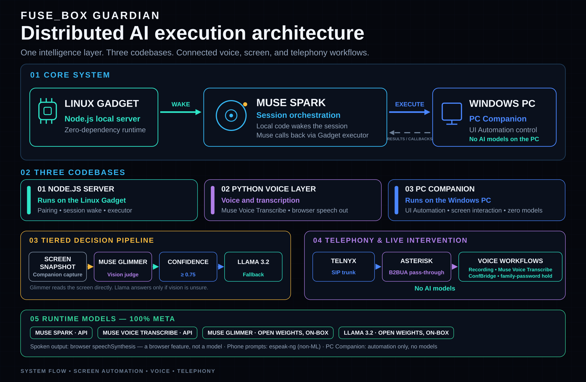

<p align="center"><strong>Coded 100% with Muse AI</strong></p>
<p align="center"><strong>All Meta Models</strong></p>

# Fuse_Box

**An always-on, safety-first AI appliance that protects people, helps them
use their computers, and takes action only through controlled, auditable
workflows.**



Fuse_Box is not a new AI model, and it is not an agent harness looking for
a problem. It is a physical appliance — a screen, a microphone, and a
speaker in the room, designed to run on a Raspberry Pi 5 with 8 GB of RAM —
that puts two safeguards in front of powerful systems:

- **The Guardian** — continuous scam protection for the people most likely
  to be targeted by it.
- **Text-first computer control** — a patient helper that reads and
  operates a PC as text, and teaches on the user's own screen instead of
  taking over.

The household hub — the board, the voice, the home connections — is the
delivery platform for those two features. Like a fuse box in a house, the
appliance sits between powerful systems and the people who live with them:
each request is routed to the smallest circuit that can handle it safely, a
breaker trips — an approval, a banner, a spoken warning — before anything
consequential happens, and the local layers keep working when the cloud is
not needed at all.

Built for the Meta Global AI Developer Hackathon (Oct 26 – Nov 4, 2026).
This repository is the hackathon source release: **all personal data,
accounts, and credentials have been removed.** Demo/seed content is
fictional, the avatar ships in its drawn (SVG) mode, and every integration
is configured locally by whoever installs it.

## Priority 1 — The Guardian

Scareware works by panicking people into calling a number. The Guardian
watches for exactly that:

- Every screen snapshot from a connected PC is judged for scams by
  **Muse Glimmer**, a Meta open-weights vision model: it reads the screen
  directly, text included — there is no separate OCR step. If vision
  cannot decide, a resident text judge (Llama 3.2 3B) rules from the
  screen's text context instead.
- In a live test on Day 1 — a real rotating scareware page, run
  deliberately on the owner's own machine — the appliance flagged it:
  it spoke the warning aloud ("do not call, do not click"), put the alert
  on the board, and the browser was closed and the desktop verified
  clean.
- The Guardian judges deceptive content only. Normal technical screens —
  command prompts, installers, settings — are explicitly not scams, and the
  appliance's own control banner carries a permanent in-code exemption,
  learned from a live false positive on Day 1.
- **The phone Guardian is built and proven on real calls (Days 2–3).**
  House calls pass through the box (an Asterisk PBX in pass-through
  between the carrier trunk and the phones), so a desk phone and an old
  analog phone on an adapter both ring as always — and if the box is
  down, the phones register with the carrier directly and ring anyway.
  Both sides of every call are transcribed live on the box. Only the
  caller's side is scanned against a scam watch list; two distinct hits
  — or a single instant-trigger phrase — and the Guardian steps in: the
  parties are separated, the caller hears hold music, and the person at
  home hears what was flagged. The caller is then asked for a family
  password before the call can be reconnected; a wrong answer ends it.
  A scam that arrives as a *text on the PC screen* makes the house
  phones ring with a spoken warning. Still ahead: the screening gate
  for unknown callers and the spoken audit ("who called today?").

## Priority 2 — Text-first computer control

The original plan was commands first, accessibility second, pixels last.
Day 1 proved why that order matters: a screenshot-guessing path worked but
was slow and fragile, so control was rebuilt around text.

| Tier | How it works | Cost / speed |
| --- | --- | --- |
| 0 — Rules + text | Commands and the Windows UI Automation (UIA) control tree, read by the one-file PC Companion on the user's PC — no dependencies, no admin rights | Free, instant |
| 1 — Vision judge | Screen snapshots judged by Muse Glimmer (Meta open weights) — it reads the screen directly, text included | Seconds |
| 2 — Text fallback | Llama 3.2 3B, resident on the hub, judging from text context when vision cannot decide | Seconds |
| 3 — Full judgment | The full agent, for real work and decisions | Only when the lower tiers cannot |

Proven on a real PC on Day 1: the Companion returned a calculator window as 47
named controls with positions; "Seven" and "Eight" were invoked **by
name** and the display read back as text — "Display is 78" — with zero
screenshots. A follow-up sequence (close, reopen, 4 × 48 =, close) ran the
same way.

Control is gated, always: PC control works only inside an open control
session, under a visible banner on the PC itself, with a stop button and a
10-minute idle auto-lock. For steps the user should take themselves,
**guide mode** posts a plain-language step strip on the PC's own screen;
the user's own click advances the flow while the appliance watches the
screen as text — teaching instead of taking over.

**The hardware hand.** Protected windows can refuse synthetic input
silently (observed live against an antivirus window on Day 1). So control
has a third rung: one command vocabulary delivered interchangeably by the
Windows companion app, a Pi in USB gadget mode (keyboard + absolute mouse, works
at login, UAC, and pre-boot screens), or an ESP32-S3 Bluetooth dongle. The
backend was built and proven **byte-exact** through a development sink
before any hardware arrived: a spoken command produces the identical HID
byte sequence whichever hand delivers it. The gadget setup script and the
ESP32 firmware source are ready for the parts.

## The delivery platform — the household hub

- **The board** (`cosmo-ui/`) — a zero-dependency Node kiosk UI: a numbered
  "NEEDS YOUR VOICE" approval queue, a live card stream (mail, texts, calls,
  calendar, camera events), and full-screen overlays for calendar, cameras,
  email, messages, music, weather, home control, network, and apps. State
  persists in `cosmo-ui/data/state.json` (created from a fictional seed on
  first run) and updates over SSE.
- **Self-updating, script-fed** — every live surface is fed by small
  polling scripts that push only on change, at zero model cost (music
  every 2 s, messages every 2 min, mail every 5 min, calendar every
  30 min). Watchdogs wake an agent only on a real failure. A model is
  involved only where judgment is needed.
- **Voice in three tiers** (`cosmo-listener/`) — microphone → energy VAD →
  Muse Voice Transcribe (Meta Model API) → wake-phrase spotting
  ("Hey Cosmo") on the returned transcript. A resident local 3B router handles reflexes
  (open a page, show a camera — silently; the user can see the screen). A
  fast cloud tier (Meta Model API) answers factual questions from board
  data in about 2–3 seconds and is **answer-only by design**: ask it to act
  and the request falls through to the full agent. Speech returns through
  the browser's built-in speechSynthesis, with barge-in. `sudo cosmo` on the box
  shows a live WAITING / LISTENING / THINKING / SPEAKING status.
- **Android apps and the Fuse Shop** (`android/`) — the box runs Android
  apps (Waydroid) full screen, with one big close button and the
  on-screen keyboard. The Fuse Shop is its store: a curated mirror of
  the F-Droid catalog, filtered to apps a person would actually use
  (launchers, keyboards, shells, and root tools are excluded by the sync
  script). Installed apps appear as tiles in the board's drawer. The
  kiosk browser rules are appliance rules everywhere: no pinch zoom, no
  split view, no drag-to-split.
- **Appliance shell** — the box boots straight to the board. One
  floating on-screen keyboard (`cosmo-osk/`) types into any app, a
  Settings page runs the box's own Wi-Fi from the screen, and every
  service is a systemd unit that comes back on its own after power
  loss. Day-by-day build notes live in `docs/progress/`.

## The safeguarding pattern, applied everywhere

- **Approval queue.** Anything that sends, spends, or speaks for the owner
  waits as a numbered item on the board, handled one at a time by voice —
  discuss, edit, skip, or hear a readback. The item's title is spoken aloud
  before any send, so a wrong number gets caught. An item is resolved only
  after its action has really been carried out.
- **Show first, speak second.** Putting something on screen is silent;
  speech is reserved for information the owner cannot see.
- **Session gates.** PC control and hardware input exist only inside an
  open, banner-visible control session.
- **No silent transfers.** Music control drives the session on whatever
  device already holds it; it never hijacks playback to another speaker
  unprompted.
- **One modal at a time.** Opening any overlay closes all others, enforced
  server-side, so what is on screen is always the one active thing.
- **No model larger than the job.** Learned the hard way on Day 1: a
  never-unload setting kept a 66 GB model resident and the kiosk browser
  took the fall. The rules now: no model larger than the job, no model
  resident without a reason, no screenshot where text will do. The full
  stack is budgeted against the Pi 5's 8 GB — roughly 1.5 GB for OS +
  board + voice, ~2.5 GB for the resident 3B, the vision judge visiting
  rather than living in RAM, and ~3.5–4 GB of headroom.

## Honest status

Fuse_Box is a systems-integration project with meaningful implementation
work behind it — Day 1 proved each of its three jobs at least once, live,
on a real machine: protection from scareware, plain-language teaching on
the user's own screen, and quiet machine-health checks in the background.
Days 2–3 put the phone Guardian on real calls through real phones,
including the step-in, the family-password check, and the warning call
for scam texts — and found and fixed the failure that only back-to-back
calls could expose.

It is not yet a proven product. Whether it becomes genuinely
differentiated will depend on proving the hardware (the Pi gadget and
ESP32 transports are backend-proven, not yet run on the parts), on a
real senior — not the builder — using it on camera, and on showing that
its safeguards outperform a conventional agent given similar tools. The
code in this repository is the current state of that work, published so
the claims can be checked.

## Layout

| Path | What it is |
| --- | --- |
| `install.sh` | The one-command installer: dependencies, appliance user, services, smoke test, reboot |
| `cosmo-ui/` | The board: `server.js`, `public/` (kiosk page), `feeders/`, `config.json` |
| `cosmo-listener/` | The voice loop: listener, speech, UI driver (`ui.py`), HA helper, status tool |
| `guardian/` | The phone Guardian: Asterisk PBX generator, per-leg call transcription (the Ear), line resampler |
| `android/` | Android on the box: Waydroid session script, full-screen close button, Fuse Shop catalog sync |
| `cosmo-osk/` | The system on-screen keyboard that types into any app |
| `cosmo-hid/` | The hardware hand: Pi USB gadget + ESP32-S3 input transports |
| `docs/progress/` | Day-by-day build notes |
| `usr/`, `etc/`, `.config/` | Install tree: kiosk session + systemd units, mirroring where files land on the box |

The reference install runs as a dedicated `cosmo` user, so paths read
`/home/cosmo/...`; adjust the units and configs if your user differs.

## Which parts are Meta models, which are browser features

Every AI model this project calls at runtime is a Meta model:

| Job | Model | Where it runs |
| --- | --- | --- |
| Judgment, conversation, one-sentence answers | Muse Spark 1.3 | Meta Model API |
| Speech-to-text (voice loop, Guardian call transcription) | Muse Voice Transcribe 1.0 | Meta Model API |
| Vision: screen scam judge, camera questions | Muse Glimmer (open weights, Apache 2.0) | **On the box owner's own hardware** (Ollama) |
| Text reflexes: intent router, screen-text judge fallback | Llama 3.2 3B (open weights) | On the box (Ollama) |

The open-weight story, for the Best Build category: **Muse Glimmer runs
inside the app itself**, served by Ollama on the owner's hardware — it
is the vision tier of the PC Guardian's scam judge and the camera
question answerer, in the live serving path (not a CI judge). Llama 3.2
3B, also open weights, runs beside it for text reflexes. Hosted Muse
Spark and Muse Voice Transcribe cover judgment and transcription;
combining hosted and open-weight Meta models is deliberate.

**Spoken output is not a model call.** The board speaks with the
browser's built-in `speechSynthesis` — a browser feature. The
Guardian's phone prompts are rendered by espeak-ng, a rule-based
formant synthesizer (plain non-ML code), cached as ordinary WAV files.
There is no text-to-speech model in the runtime path, and no non-Meta
model runs anywhere in the project: no Whisper, no openWakeWord, no
local TTS models, no third-party OCR (the screen judge reads with
Glimmer). Plain non-ML code — Asterisk (the PBX), ffmpeg, the Wyoming
and ordinary HTTP plumbing — does the rest.

## Configuration & secrets

**No secrets are in this repo, by design.** The code reads credentials
from files on the box at runtime, and those files are git-ignored:

- Meta Model API key: `~/.config/cosmo-voice/meta_api_key` (0600) —
  powers the cloud reflex tier (Muse Spark) and all speech-to-text
  (Muse Voice Transcribe). Without it the box still runs; voice input
  and call transcription simply stay off.
- Home Assistant long-lived token: the path set by `haTokenPath` in
  `cosmo-ui/config.json`.
- Guardian phone credentials (SIP user/password, line number) and the
  family password: `~/.config/cosmo-guardian/secrets.json` (0600) —
  entered on the box's own screen, never typed into a chat or a terminal.
- Weather location, camera and integration settings:
  `cosmo-listener/config.json` and
  `cosmo-ui/config.json` — shipped here with placeholder/demo values.

Mail, messages, social, and music are driven by the agent session through
its own connector CLIs on the agent host (see `preamble.txt`); wire up
whichever connections you want — the board works without any of them.

## Demo data

First run seeds a handful of clearly-marked demo cards (pharmacy follow-up,
a PC-guardian scam drill, a bakery callback). The weather demo location is
New York, NY; the network feeder ships with example devices
(`192.168.1.x`, `00:11:22:...` MACs). Replace all of it with your own
configuration — nothing in the demo data is real.

## Avatar

`cosmo-ui/AVATAR_MODE` ships as `svg`: the board draws a built-in animated
bot. The reference install uses personally generated video clips for the
avatar instead; those stay on the owner's machine and are **not** part of
this repo. To use clips, drop them into `cosmo-ui/public/avatar/` (see the
`.gitkeep` there) and set `AVATAR_MODE` to `real`.

## Quick start — one command

On a clean **Ubuntu 24.04 (x86_64)** machine with at least ~6 GB of RAM
and ~20 GB free:

```sh
git clone https://github.com/coopersplayground/FuseBox.git && cd FuseBox && sudo bash install.sh
```

That is the whole install. The installer checks the machine, installs
every dependency (Node for the board, the Python voice loop, Chrome and
Brave for the screens, Asterisk for the phone Guardian, Ollama with the
small Llama 3.2 judge, espeak-ng for the Guardian's phone prompts, Waydroid
for the Android side), creates the appliance's `cosmo` user, lays the
tree into place, enables every service, smoke-tests the board, and
reboots into the Fuse Box — board full screen, voice live, demo data on
the board. It is idempotent (run it again to update) and logs to
`/var/log/fusebox-install.log`.

Flags: `--no-android` skips Waydroid and the app shop, `--no-reboot`
stays up at the end, `--dry-run` prints every action and changes
nothing. Components report OK / SKIPPED / DEGRADED at the end — a
machine whose kernel lacks Android's binder module, for example, still
comes up as a Fuse Box, just without the Android side.

After the reboot, the only setup left is the owner's own: complete the
Guardian setup on the board to bring the phone line up (the PBX config
is generated on the box from the line details entered there — a watcher
service runs the generator the moment they land), set the weather
location in `cosmo-ui/config.json`, and drop in API keys as files only
if you want the cloud tiers (see Configuration & secrets above).
